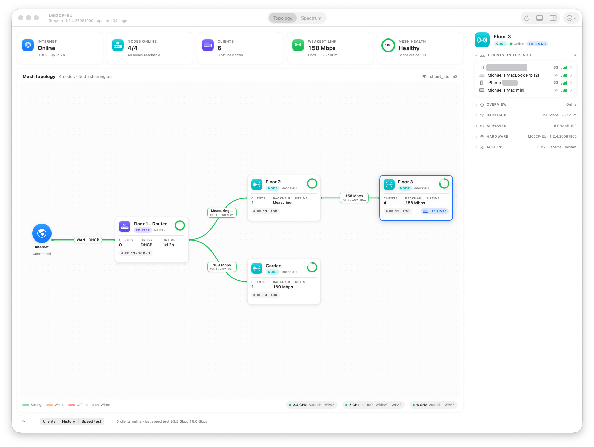
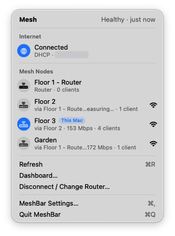
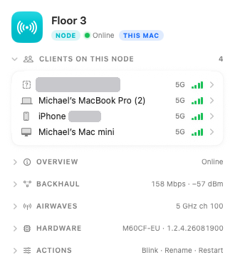
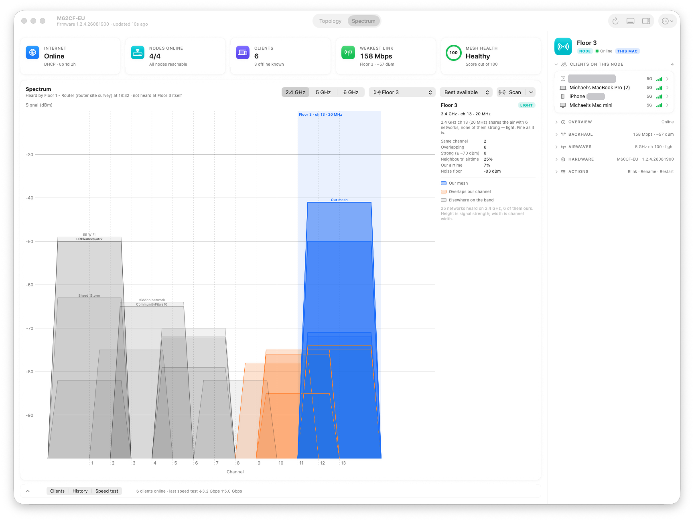
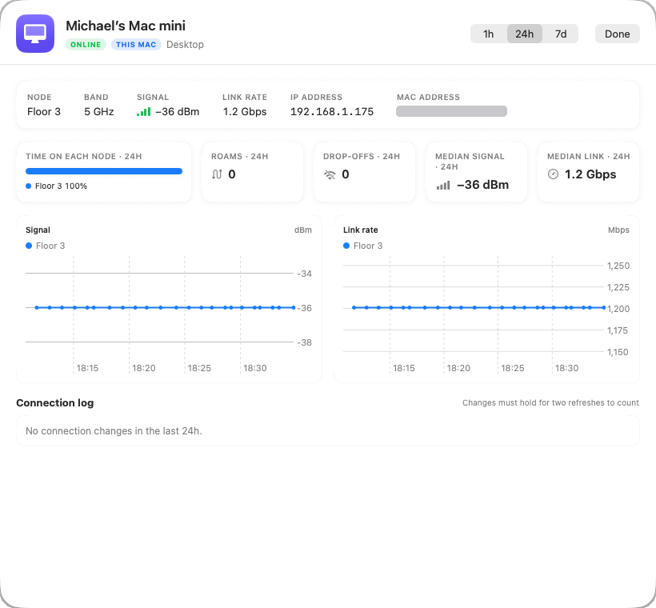
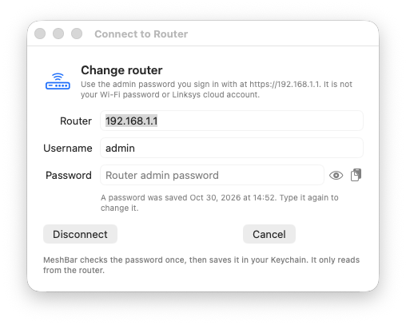
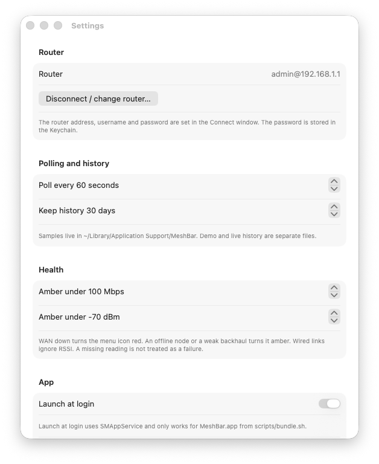

<p align="center">
  
</p>

<h1 align="center">MeshBar</h1>

<p align="center">
  A native macOS menu-bar app and dashboard for Linksys Velop and Pinnacle mesh Wi-Fi.<br>
  It reads your router's local JNAP API. No cloud account and no telemetry.
</p>

<p align="center">
  <a href="https://github.com/wileyadvanced/meshbar/actions/workflows/ci.yml"></a>
  
  
  <a href="LICENSE"></a>
</p>



## What it is

The Linksys app tells you "Connected". MeshBar shows you **how** the mesh is connected. It shows which node each satellite hangs off, how fast every backhaul link is, which node each phone and laptop is on, and how that changes over time. Everything runs on your Mac and talks only to your router over your LAN.

It is written in Swift and SwiftUI with Swift Charts, and has no third-party dependencies. The JNAP client, parser, health rules and history store live in a separate `MeshBarCore` library that is unit-tested with fixture data, so most of it can be tested without a router.

All screenshots are of a real Pinnacle 2.2 mesh: one router and three satellites.

## Features

### Menu bar



- A monochrome template icon that behaves like Apple's own status items. The bars follow the signal of the node *this Mac* is on.
- `wifi.exclamationmark` means a node is offline, a backhaul is weak or some data could not be read. `wifi.slash` means the internet is down.
- The dropdown is styled like the Wi-Fi menu. It shows internet status, every node with its parent, backhaul speed and client count, and which node this Mac uses.
- Refresh (⌘R), Dashboard…, Settings… (⌘,) and Quit.

<br clear="right">

### Dashboard: topology

- Live mesh tree: Internet → router → satellites, daisy chains included.
- Each edge is labelled with link speed, band and RSSI. Colours mean strong, weak, offline or wired.
- A stat strip shows internet, nodes online, clients, the weakest link and a 0–100 mesh-health score.
- Radio chips for 2.4, 5 and 6 GHz show channel, width and security.
- The bottom drawer has Clients, History and Speed test, collapsed by default so the topology gets the room.

### Inspector



- Click a node to see its clients (band and signal bars), overview, backhaul, airwaves and hardware.
- **Actions** are Blink LED, Rename and Restart this node (`core/Reboot2`). They are behind confirmations and never mixed up with **Restart entire router** (`core/Reboot`), which has its own button and its own confirmation.

<br clear="right">

### Spectrum



- Every network the router (or this Mac) can hear, drawn as channel-width trapezoids. Height is signal strength.
- Your own mesh is blue. Networks overlapping your channel are orange, everything else is grey.
- Per-band verdicts (clear, light, busy) cover same-channel and overlapping networks, neighbours' airtime and the noise floor. When a better channel is available, MeshBar says so.
- **Scan at router** reads the router's own site survey (read-only, about 30 s, at most once a minute). **Scan from this Mac** uses CoreWLAN.

### Client connection history



- Every poll records each client's node, band, RSSI, link rate, IP and online state.
- Double-click a client (or use ⓘ or the context menu) to open its history. It has 1 h, 24 h and 7 d charts of signal and link rate, coloured by node, with roams and drop-offs marked.
- It shows time spent on each node, roam and drop-off counts, and median signal and link rate.
- A **connection log** lists roams, band changes, drop-offs, reconnects and IP changes. Changes are debounced: a change must hold for two polls to count, so one bad reading doesn't log a roam.

### Speed test

- Runs the router's own speed test (`healthcheck/RunHealthCheck`). The router measures the WAN, not your Wi-Fi.
- Results are shown in Mbps or Gbps with the raw kbit/s counter alongside. Failed runs say so instead of showing 0.

### Connect and Settings

<p>
  
  
</p>

- The Connect window checks the admin password once and stores it in the macOS **Keychain**. It shows the router's lockout counter if the password is wrong.
- Settings cover the poll interval (default 60 s), history retention (default 30 days), the amber thresholds for backhaul speed and RSSI, launch at login, Demo mode, and HTTPS and certificate options.
- Notifications fire when a node goes offline, changes parent, or its backhaul drops below the threshold. They are debounced, and the first reading never notifies.
- **Demo mode** shows a fake mesh, so you can try the UI without a router.

## Supported models

| Model | Status |
| --- | --- |
| Pinnacle 2.2 **M62CF-EU** (firmware 1.2.4) with **M60CF-EU** satellites | ✅ Developed and used daily against this mesh |
| Velop MX4200 / MX5300 | 🟡 Expected to work (same JNAP services), untested |
| Velop WHW03 | 🟡 Expected to work, untested |
| Linksys routers without mesh | ⚪️ Probably partial: WAN, clients and radios only |

Field names move between firmware builds. Every field is parsed as optional, and unknown field **names** (never values) are logged instead of crashing. If your model misbehaves, please open an issue with the model, the firmware and a *redacted* `GetDevices3` / `GetBackhaulInfo2` reply.

## Install

### Download

Grab `MeshBar-0.1.0.zip` from [Releases](https://github.com/wileyadvanced/meshbar/releases), unzip it and drag **MeshBar.app** to Applications.

> **Gatekeeper:** release builds are **ad-hoc signed, not notarized**. The first time you open MeshBar, **right-click (or Control-click) MeshBar.app → Open → Open**. On macOS 15 and later, if there is no Open button, go to **System Settings → Privacy & Security** and click **Open Anyway**. You only have to do this once.

### Build from source

You need macOS 14 or later and Xcode 15 or later (Swift 5.9).

```bash
git clone https://github.com/wileyadvanced/meshbar.git
cd meshbar
swift test                 # needs Xcode's XCTest; see note below
scripts/bundle.sh          # release build → dist/MeshBar.app (ad-hoc signed)
open dist/MeshBar.app
```

`swift build` and `scripts/bundle.sh` work with the Command Line Tools alone. `swift test` needs Xcode. If `xcode-select -p` points at the CLT, run `DEVELOPER_DIR=/Applications/Xcode.app/Contents/Developer swift test`.

You can also open `Package.swift` in Xcode and run the **MeshBar** scheme. For everyday use, run the bundled app: launch at login and the local-network `Info.plist` only apply to `MeshBar.app`.

## Quick start

1. Launch MeshBar. A Wi-Fi icon appears in the menu bar (there is no Dock icon until you open a window).
2. Click it, choose **Connect…**, and enter the router address (default `192.168.1.1`), username `admin` and the **router admin password**. This is the password you use at `https://192.168.1.1`, not your Wi-Fi password and not your Linksys cloud account.
3. Linksys routers use a self-signed HTTPS certificate. MeshBar offers to trust it **for that host only**.
4. Open **Dashboard…**. The first full picture takes one poll. Satellite backhaul can show *Measuring…* for a minute after a refresh.
5. Allow notifications if you want offline and weak-link alerts. Allow Location only if you want the Mac's own Wi-Fi scan to show network names.

There is no router? Turn on **Demo mode** in Settings.

## How it works

```
 MeshBar.app (SwiftUI)                    MeshBarCore
 ┌──────────────┐  poll every 60 s   ┌──────────────┐   HTTPS POST /JNAP/   ┌─────────────┐
 │ Menu bar     │ ─────────────────▶ │ JNAPClient   │ ────────────────────▶ │ Master node │
 │ Dashboard    │ ◀── MeshSnapshot ─ │ Parser       │ ◀──── JSON ────────── │ (router)    │
 │ Client sheet │                    │ Health/Alerts│                       └─────────────┘
 └──────┬───────┘                    │ HistoryStore │──▶ SQLite in ~/Library/Application Support/MeshBar
        └── Keychain (password)      └──────────────┘
```

- MeshBar only ever talks to the **master** router. Satellites are often not reachable on the LAN, and the master knows the whole mesh.
- Polls go through a **gate**: one poll at a time, and clicks during a poll collapse into one follow-up. Mashing Refresh can't hammer the router.
- Satellite backhaul is re-measured (`RefreshSlaveBackhaulData`) at most every 5 minutes, or when you press Refresh.
- Node and client samples go into SQLite (falling back to JSON lines). They are pruned after the retention period.

More detail is in [docs/ARCHITECTURE.md](docs/ARCHITECTURE.md).

### JNAP notes

JNAP is the JSON-over-HTTPS API behind the Linksys web UI: `POST https://<router>/JNAP/`, with the action in an `X-JNAP-Action` header and Basic credentials in `X-JNAP-Authorization`.

- **Pinnacle batch refusal:** firmware 1.2.4 rejects a whole `core/Transaction` with `_ErrorUnauthorized` when one child action is refused, even with the right password. MeshBar checks the password once with `core/CheckAdminPassword`. If it's right, MeshBar sends the reads one by one for the rest of the session.
- **Units:** `GetBackhaulInfo2` reports `speedMbps` in Mbps. `GetHealthCheckResults` reports `downloadBandwidth` and `uploadBandwidth` in **kbit/s** (3 170 000 = 3.17 Gbps).
- **No parent pinning:** no JNAP action pins a satellite to a parent. MeshBar shows topology-optimization settings read-only and does not pretend otherwise.

The full list of actions, request shapes, quirks and read/write split is in [docs/JNAP.md](docs/JNAP.md). The router's advertised catalog is in [docs/jnap-actions.md](docs/jnap-actions.md).

## Privacy & security

- **The password lives only in the Keychain.** It is not stored in preferences, logs, history or crash output. MeshBar sends it only to the router you configured.
- **Read-mostly.** Polling uses read actions only. Write actions (blink, rename, restart a node, restart the router, run a speed test) need a click, and the restarts need a confirmation.
- **No phone-home.** There is no analytics, no update check and no cloud. History stays in `~/Library/Application Support/MeshBar` and contains device names, IPs and MACs from your network, so treat it accordingly.
- **Narrow certificate trust.** Trust for the self-signed certificate is opt-in and pinned to the configured host. It is not a global ATS exception (`NSAllowsLocalNetworking` only covers local addresses).
- **Redacted logs.** Unknown JSON keys are logged by name only, never by value. The router's site-survey page is parsed in memory and discarded. For Wi-Fi security, only the mode is kept; passphrases are never stored.
- The repository's tests and fixtures use documentation-range values only (`192.0.2.x`, `203.0.113.x`, `02:…` MACs). The screenshots above are of the maintainer's own network, published deliberately.

## Roadmap

- [ ] Signed and notarized builds, plus Homebrew cask
- [ ] Wider model coverage (Velop MX series, WHW03) from community reports
- [ ] Per-node history drill-down like the client sheet
- [ ] Export history (CSV)
- [ ] Optional widgets (WidgetKit) for mesh health
- [ ] Per-client throughput, if a firmware exposes it (Pinnacle 1.2.4 does not)

## Contributing

Issues and PRs are welcome. See [CONTRIBUTING.md](CONTRIBUTING.md). The most useful contribution is a **model report**: the model, the firmware and redacted JNAP replies. Please never post your admin password, Wi-Fi passphrase or unredacted serials.

For trouble with certificates, passwords and permissions, see [docs/TROUBLESHOOTING.md](docs/TROUBLESHOOTING.md). Release notes are in [docs/CHANGELOG.md](docs/CHANGELOG.md).

## Credits

- Dashboard ideas (the mesh tree, per-link speed and RSSI, clients per node) come from [chinawrj/linksys-meshscope](https://github.com/chinawrj/linksys-meshscope). MeshBar contains none of that project's C, ESP32, firmware or MQTT code.
- JNAP action names and response fields were cross-checked against [uvjim/pyvelop](https://github.com/uvjim/pyvelop).
- Linksys, Velop and Pinnacle are trademarks of their owners. MeshBar is an independent project and is not affiliated with or endorsed by Linksys.

## License

[MIT](LICENSE) © 2026 Michael Wiley
